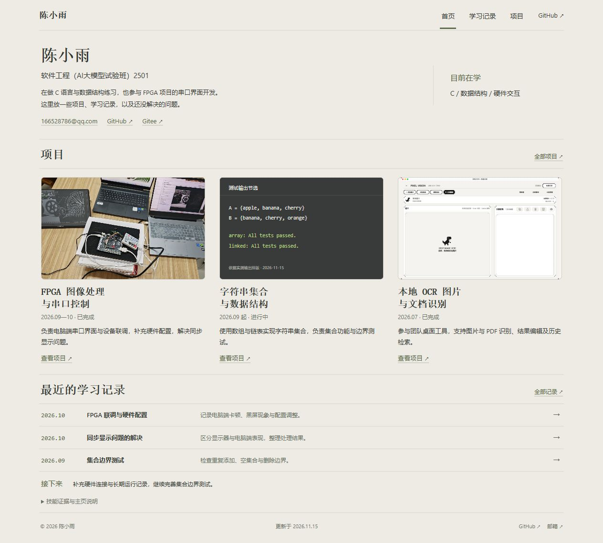

# 陈小雨的个人主页

个人项目、学习记录和实践笔记。

在线访问：https://Jingzhe-chen714.github.io/personal-growth-homepage/

联系邮箱：166528786@qq.com

软件工程（AI大模型试验班）2501 · 陈小雨。

目前主要做 C 语言与数据结构练习，也参与 FPGA 视觉项目的串口界面开发。



## 这里有什么

| 页面 | 内容 |
| --- | --- |
| [个人主页](index.html) | 关于我、学习方向、技能实践与联系方式 |
| [学习手记](learning.html) | 项目复盘、关键词搜索、分类筛选与记录表单 |
| [项目作品](projects.html) | 项目介绍、个人分工、技术细节与代码片段 |

还有一份[完整单文件版](陈小雨-个人成长主页.html)，将所有页面内容、样式与交互放在一个 HTML 中，方便离线浏览和分享。

## 本地浏览

这是一个使用 HTML、CSS 和原生 JavaScript 的静态网站，不需要安装依赖。

下载后直接打开 `index.html`，或在项目目录启动本地服务：

```sh
python -m http.server 8765 --bind 127.0.0.1
```

然后访问 <http://127.0.0.1:8765/>。页面适配桌面和手机，支持键盘操作。

## 最近的实践

- [Ti60 实时视觉与串口控制](https://github.com/Jingzhe-chen714/fpga)：我负责串口界面，2026年9—10月完成，加入分配器和采集卡解决同步显示问题。仓库目前为私有。
- [数据结构练习](https://gitee.com/chen-xiaoyu33/data-structure-course-design)：2026年9月开始，目前进行中；我负责集合与测试，比较数组和链表实现，并检查重复元素、空集合、容量和删除边界。
- [本地 OCR 图片与文档识别工具](https://github.com/weijiayue19/project6)：2026年7月完成的团队项目，使用 Python、PaddleOCR、Tkinter 和 SQLite。

## 记录与更新

学习手记页支持新增记录，并将内容保存在当前浏览器中；可以导出 JSON 备份。这些记录不会自动同步到 GitHub，换设备或清除浏览器数据前请先导出。

首页、项目详情、样式与反馈表单在 `templates/` 中维护；学习记录与共享页面框架位于 `tools/build.py`。修改后运行：

```sh
python tools/build.py
```

脚本会重新生成三个独立页面、共享样式与脚本，以及完整单文件版。也可以直接编辑 HTML；如果使用生成脚本维护，请将改动同步回模板，以免下次生成时被覆盖。

后续会继续补充串口联调记录、集合测试和新的项目实践，也计划探索大模型应用开发。

## 发布方式

网站通过 GitHub Pages 发布，发布来源为 `main` 分支的仓库根目录。根目录保留 `.nojekyll`，页面、样式和脚本作为静态文件提供。推送后等待 Pages 构建完成即可更新线上内容。

## 找到我

[GitHub · Jingzhe-chen714](https://github.com/Jingzhe-chen714)

## 项目证据与反馈

- `assets/evidence/set-test-report.txt`：2026-11-15用GCC 16.2.0重新运行当前本地副本的数组与链表集合测试，记录源码提交号与完整输出。
- `assets/evidence/set-test.svg`：依据上述实测输出绘制的结果图，不是软件运行截图。
- `assets/evidence/ocr-workbench.png`：来自OCR团队仓库`html/assets/主工作台.png`的原始工作台初始界面截图。
- `assets/evidence/fpga-field-photo.jpg`：本人提供的联调现场照片，仅按网页加载需要缩小尺寸并转换为 JPEG；保留原设备和屏幕内容。
- `assets/evidence/fpga-poster.png`：本人提供的团队项目海报，海报中的算法与动态效果为视觉示意，非实测截图。
- `assets/evidence/set-test-preview.svg`：首页使用的实测输出节选排版图，非终端截图；完整输出仍以测试记录为准。
- 学习记录页的反馈表单可生成草稿并复制，或打开邮件撰写窗口；没有后台留言服务，不会自动发送。模板与逻辑分别位于`templates/feedback.html`和`templates/feedback.js`，生成后进入独立HTML与`assets/app.js`。
- 项目时间为本人确认的2026年7月、9月至10月，早于本次更新日期2026-11-15。

## 公开说明与渐进增强

- [FPGA公开项目说明](docs/fpga-project.md)、[联调现场照片](assets/evidence/fpga-field-photo.jpg)与[项目海报](assets/evidence/fpga-poster.png)公开可读；原始FPGA工程仍由原私有仓库维护。旧版[联调记录示意](assets/evidence/fpga-field-notes.svg)保留为补充文字图，不冒充现场照片。
- 默认提交按钮可用。启用脚本时，表单在本页保存或生成草稿；无脚本时，表单使用原生`mailto`、`POST`、`text/plain`交给已配置的邮件客户端，由使用者确认发送。没有后台留言服务。其基础行为参见[HTML表单提交规范](https://html.spec.whatwg.org/multipage/form-control-infrastructure.html)。
- 搜索、筛选、复制与导出属于脚本增强功能；无脚本时隐藏增强控件，仍可浏览三页全部内容、使用页面查找和邮件表单。
- [内容更新约定](CONTRIBUTING.md)记录时间、状态、证据标注、模板维护和发布检查要求。
